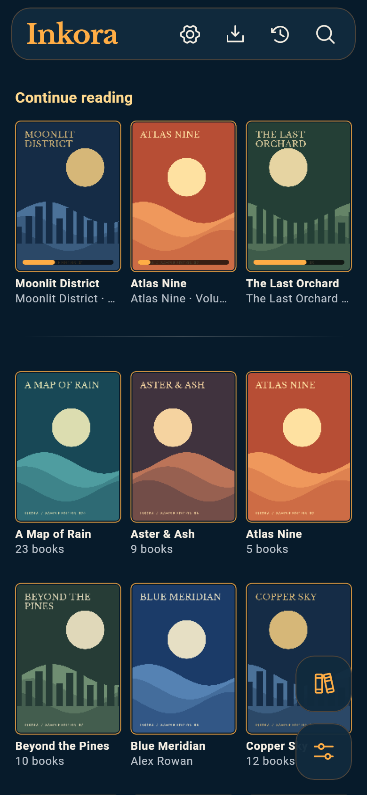
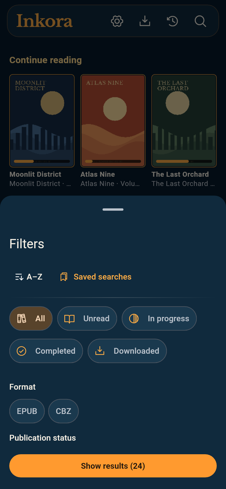
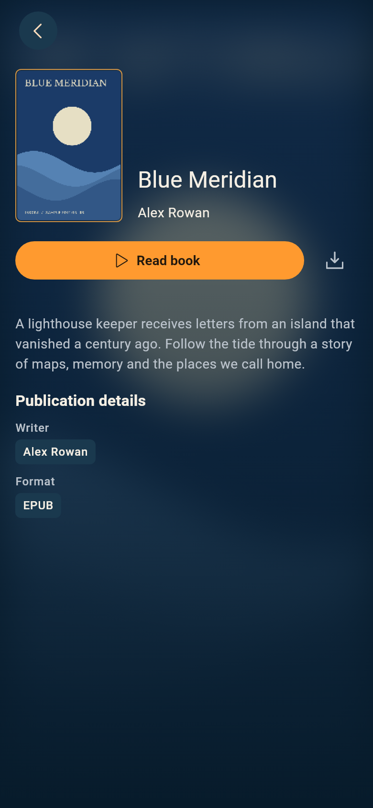
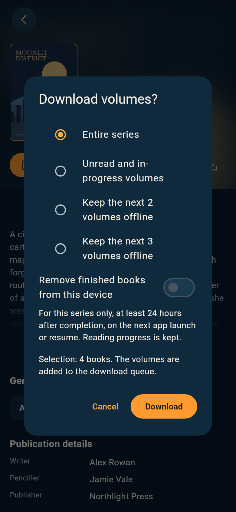
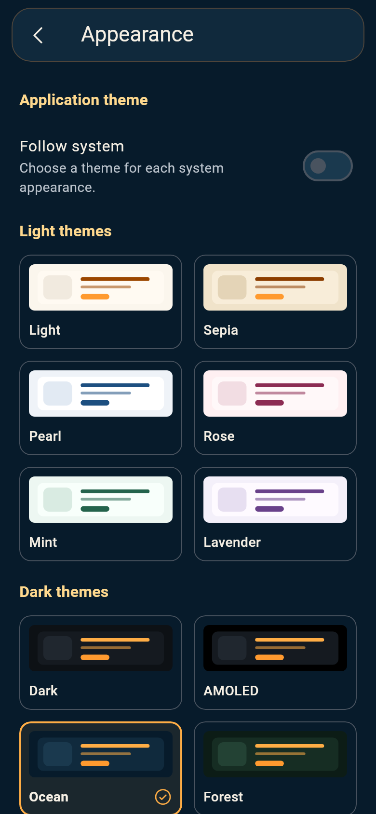
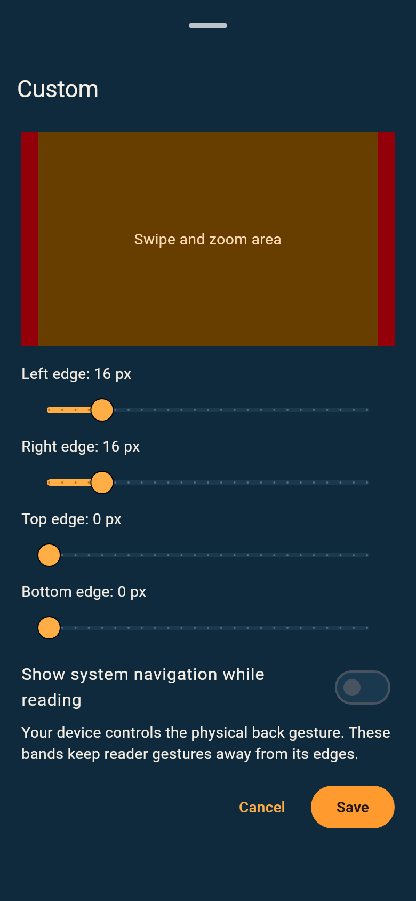
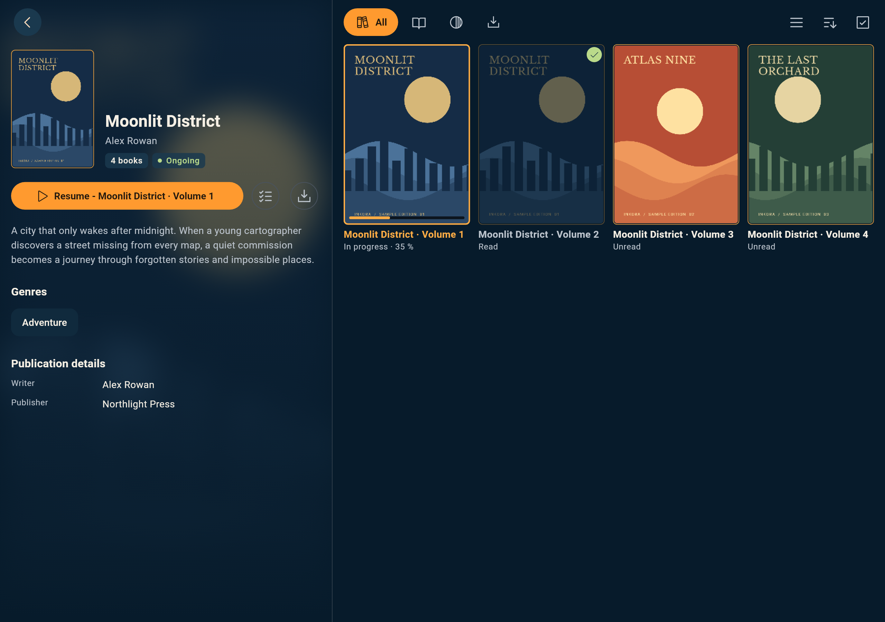

<h1>
  <picture>
    <source media="(prefers-color-scheme: dark)" srcset="assets/branding/inkora-wordmark-dark.png">
    
  </picture>
</h1>

**Your Komga library, wherever you read.**

Read your manga, comics, webtoons and ebooks on your phone or tablet. Connect
Inkora to your [Komga](https://komga.org/) server, find your next read and pick
up where you left off. Download a few volumes before you leave and keep reading
without a connection.

[Download for Android](https://github.com/simon-verbois/inkora/releases) ·
[Visit the website](https://simon-verbois.github.io/inkora/) ·
[See what's new](CHANGELOG.md)

Inkora is in active development. Android is the currently tested platform;
iOS support is under development and has not yet been validated on a native
build. This page presents the development version, so some features may arrive
in a later APK.

If you enjoy Inkora, you can support its development:

<a href="https://buymeacoffee.com/simonverbois"></a>

## Pick up where you left off

Your current reads are waiting at the top of Home. Tap a cover to return
straight to your book, or revisit a recent read from your reading history.
Your progress syncs with Komga when you reconnect.

<p>
  
</p>

## Find your next read

Browse your libraries, collections and reading lists, or narrow things down by
format, reading status, author or genre. Save searches you return to often, such
as unread manga or books already downloaded to your device.

Open a book to see its synopsis and publication details, or explore an author's
other work. Switch between your saved servers and choose which libraries appear
in **Settings → Servers**.

<p>
  
  
</p>

## Take the next volumes with you

Download a whole series, just the unfinished volumes, or keep the next two or
three ready to read. Inkora refills that selection as you read while the app is
open, within your download limits.

Manage the queue, set a storage limit and choose Wi-Fi-only downloads. You can
also have finished volumes removed from your device after at least 24 hours,
while keeping your reading progress.

<p>
  
</p>

## Read your way

Turn pages through manga and comics, scroll through webtoons, or settle into an
EPUB or PDF. Choose your reading direction and page layout, tune image scaling
and sharpening, and adjust EPUB fonts and spacing. Page thumbnails, bookmarks
and notes help you find your place again; finishing a volume lets you continue
to the next one.

Make the rest of the app comfortable too: choose from twelve light and dark
palettes, adjust gesture areas and set reading defaults for each library.
Choose which book details appear and how many covers fit across Home in portrait
and landscape.

<p>
  
  
</p>

The interface is available in Czech, Dutch, English, French, German, Greek,
Hungarian, Italian, Polish, Portuguese, Romanian and Spanish. You can export
settings and bookmarks to a file and preview them before importing; credentials,
books and reading progress stay out of that file.

## Give your library room

On a tablet, series information sits beside the volumes so you can read the
synopsis and choose your next book in the same view. The library and reading
layouts adapt to portrait and landscape, whether you read on a phone or a
larger screen.

<p>
  
</p>

*Screens show the development app in English with fictional books and original
sample covers. They are rendered by Flutter, rather than photographed on a
device.*

## Get started

Inkora connects to your own Komga library. You'll need a reachable server and an
account with access to its books; Inkora does not include books or host a server.

1. [Download the Android APK](https://github.com/simon-verbois/inkora/releases)
   and install it on your phone or tablet.
2. Open Inkora and enter your `http://` or `https://` server address, including
   its port and subpath if applicable.
3. Sign in with a Komga API key or your username and password.
4. Follow the guided setup, choose a book and start reading.

HTTP is supported for self-hosted servers; it sends credentials and reading data
without encryption. Prefer HTTPS, especially outside a trusted local network.

Server credentials are kept in platform secure storage. Downloads, local reading
positions and pending progress updates remain scoped to their server account.

<details>
<summary>Build from source</summary>

The pinned toolchain is recorded in [toolchain.lock.json](toolchain.lock.json):
Flutter 3.47.7 / Dart 3.13.5, JDK 21 and Android SDK 36. Install those tools and
accept the Android SDK licenses before building. Python 3 is required for the
version-aware build wrapper.

```bash
flutter pub get --enforce-lockfile
flutter analyze
flutter test

# Supply the paths to your installed SDKs.
INKORA_FLUTTER_ROOT=/path/to/flutter \
INKORA_JAVA_HOME=/path/to/jdk \
INKORA_ANDROID_HOME=/path/to/android-sdk \
scripts/build.sh apk --release
```

The APK is written to `build/app/outputs/flutter-apk/app-release.apk`. Local builds
use a development signing key unless a distribution keystore is configured. iOS
builds require macOS and Xcode; native iOS verification is still pending.

Root [VERSION](VERSION) supplies the Android version. [CHANGELOG.md](CHANGELOG.md)
records changes and development history. Both are bundled in the app and can be
read offline from **Settings → About Inkora**.

For local preview and hosting of the presentation website, see
[the Pages guide](docs/PAGES.md).

</details>

## License and F-Droid

Inkora's original code and project-authored assets are available under the
[MIT License](LICENSE). Third-party components retain their own licenses; see
[NOTICE](NOTICE).

The repository includes English/French store descriptions and a source-build
candidate for F-Droid. Official inclusion and reproducible signing are pending;
see [F-Droid packaging](fdroid/README.md) for the build recipe and remaining gates.

## Credits

Inkora is built with Flutter and uses Readium for EPUB and PDFium through pdfrx
for PDF. Bundled third-party notices are available in the app's license screen
and in [PDF notices](assets/licenses/pdfium-notices.txt),
[EPUB notices](assets/licenses/readium-sdk.txt), [font notices](assets/fonts/OFL.txt)
and [icon notices](assets/icons/LICENSE.txt).

---

This project is developed with assistance from agentic AI. It is experimental
and may contain errors; please review the code and report any issues you find.
