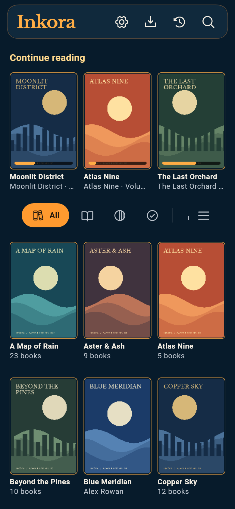
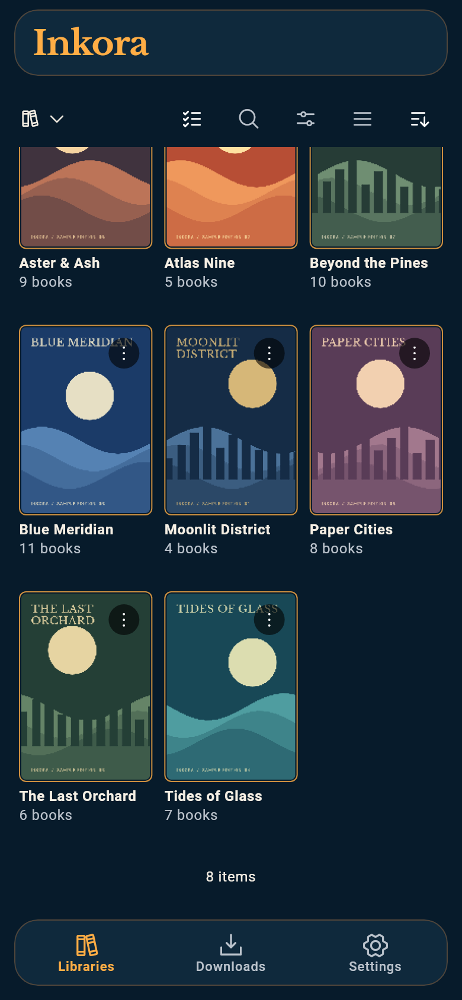
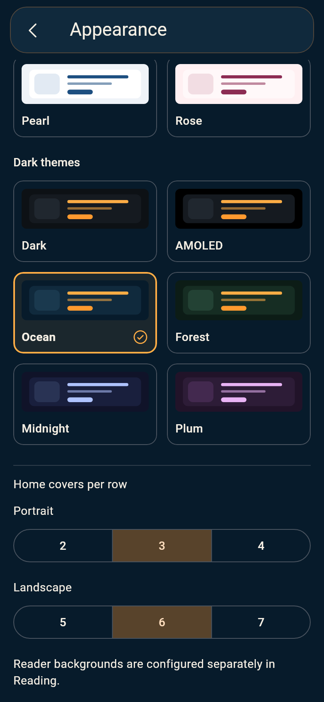
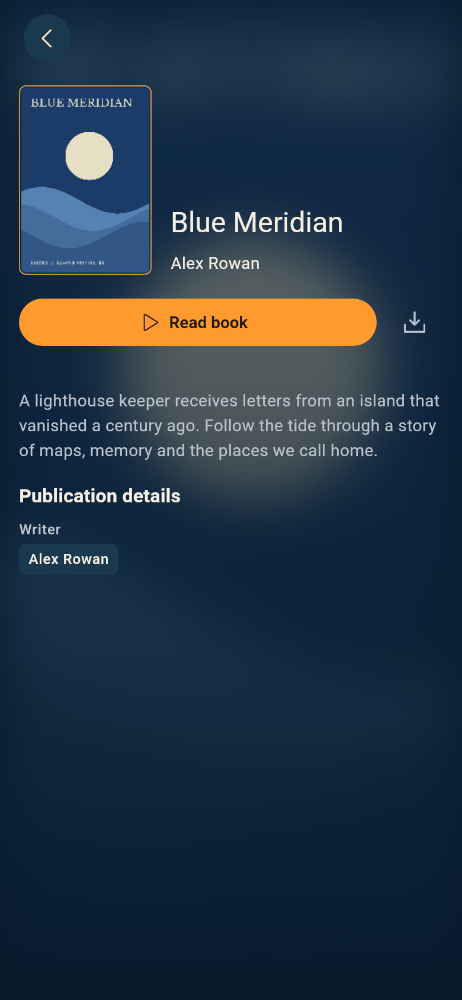
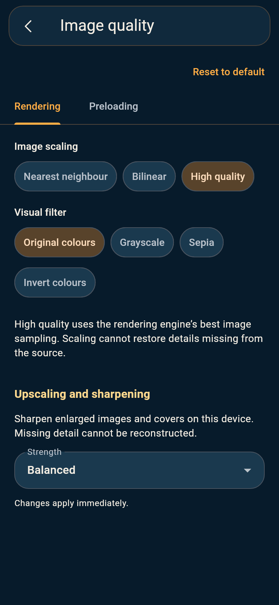
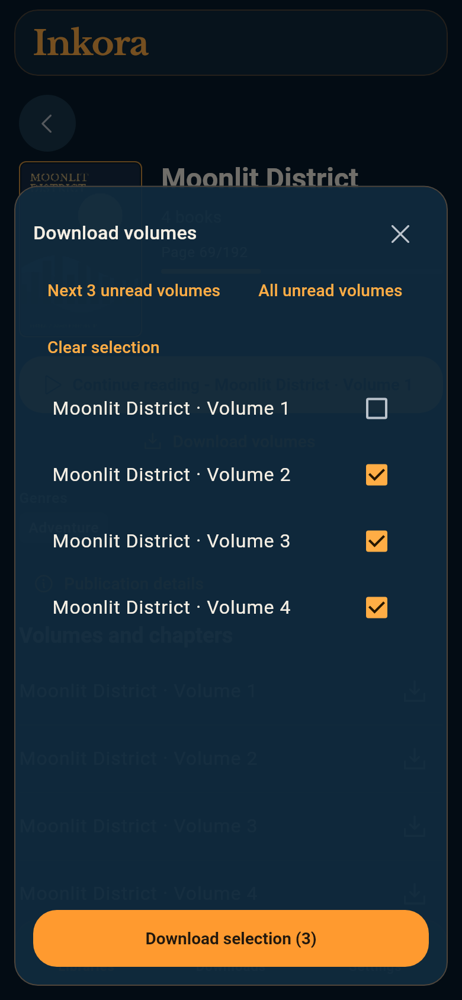
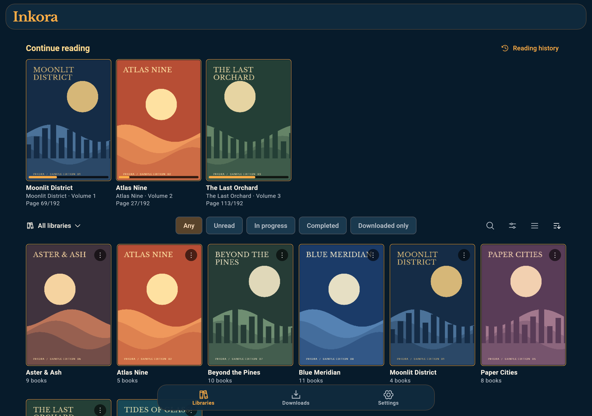
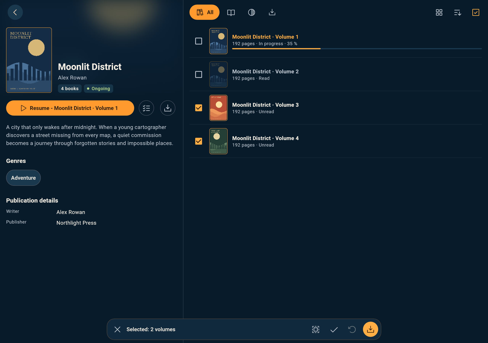
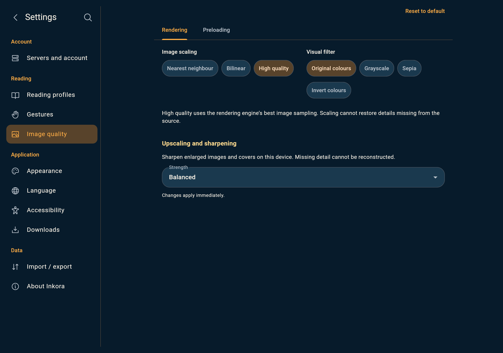

# Inkora

<a href="https://buymeacoffee.com/simonverbois"></a>

Your Komga library, wherever you read.

Inkora is a reader for manga, comics, webtoons and ebooks, built for phones and
tablets. Connect your own [Komga](https://komga.org/) server, pick up where you left
off and keep books available offline.

**In active development.** Android is the currently tested platform. iOS support
is under development and has not yet been validated on a native build. See
[Releases](https://github.com/simon-verbois/inkora/releases) for Android APKs.

**Current development features are described below.** Published APKs may lag
behind this branch; see [the changelog](CHANGELOG.md).

## A home for your reading

- **One library, every format.** Browse manga and comics, scroll through webtoons,
  or read EPUB and PDF books.
- **Continue in one tap.** Open the exact book you were reading, with progress
  synchronized to Komga when you reconnect.
- **Take books offline.** Download volumes, manage the transfer queue and set
  storage and Wi-Fi preferences. From a series, choose all volumes or only
  unread and in-progress books. Optionally remove finished downloads for that
  series after at least 24 hours, keeping reading progress.
- **Keep your place.** Preview page thumbnails, save bookmarks and notes, and
  continue to the next volume from the completion screen. Reopen recent books
  from device-local reading history.
- **Make it yours.** Choose from twelve light and dark palettes, including Mint
  and Lavender. Set reading direction, page layout, gestures and EPUB typography.
  Use one scaling/filter choice for all image formats, with sharpening on the
  same page. Configure reading defaults per visible library and reset individual
  settings pages when needed. Set Home covers per row separately
  for portrait and landscape windows.
- **Find your next read.** Search your catalogue and browse series, collections
  and reading lists. Filter by format, reading status or downloaded availability.
- **Choose what appears.** Edit multiple server connections and choose the
  visible libraries for each account in dedicated popups. All accessible
  libraries are selected by default.
- **Explore each book.** Open individual ebook details and author pages. Browse
  series information beside its volumes on tablets, with completed covers muted
  and selection actions floating over the page. Catalogue links ask before
  opening an external site.
- **Keep browsing comfortably.** Compact controls attach to Home’s header as you
  scroll. Quick filters preserve your position, and adaptive side margins keep
  the cover grid spacious on both phones and tablets.
- **Bring settings along.** Export settings and bookmarks to a file, preview an
  import, or scan an existing settings QR code. Credentials,
  books and reading progress are excluded. Account-specific files require the same
  server/account; existing QR settings are portable.
- **Read in your language.** The interface supports Czech, Dutch, English,
  French, German, Greek, Hungarian, Italian, Polish, Portuguese, Romanian and
  Spanish.

## Screenshots

Real app screens in English, rendered with a fictional demonstration catalogue
and original sample cover artwork. Captures show the development version and
are rendered by Flutter; they are not device photographs.

| Library home | Library | Appearance |
| --- | --- | --- |
|  |  |  |

| Ebook details | Image quality | Batch downloads |
| --- | --- | --- |
|  |  |  |







## Get started

You need a reachable Komga server and an account with access to its libraries.
Inkora does not provide books or a hosted server.

1. Open Inkora and enter your `http://` or `https://` server address, including
   its port and subpath if applicable.
2. Sign in with a Komga API key or your username and password.
3. Complete the guided setup, browse your libraries and open a book.

HTTP is supported for self-hosted servers; it sends credentials and reading data
without encryption. Prefer HTTPS, especially outside a trusted local network.

Server credentials are kept in platform secure storage. Downloads, local reading
positions and pending progress updates remain scoped to their server account.
You can change accounts and visible libraries in **Settings → Servers**.

## Build from source

The pinned toolchain is recorded in [toolchain.lock.json](toolchain.lock.json):
Flutter 3.47.7 / Dart 3.13.5, JDK 21 and Android SDK 36. Install those tools and
accept the Android SDK licenses before building. Python 3 is required for the
version-aware build wrapper.

```bash
flutter pub get --enforce-lockfile
flutter analyze
flutter test

# Supply the paths to your installed SDKs.
INKORA_FLUTTER_ROOT=/path/to/flutter \
INKORA_JAVA_HOME=/path/to/jdk \
INKORA_ANDROID_HOME=/path/to/android-sdk \
scripts/build.sh apk --release
```

The APK is written to `build/app/outputs/flutter-apk/app-release.apk`. Local builds
use a development signing key unless a distribution keystore is configured. iOS
builds require macOS and Xcode; native iOS verification is still pending.

Root [VERSION](VERSION) supplies the Android version. [CHANGELOG.md](CHANGELOG.md)
records changes and development history. Both are bundled in the app and can be
read offline from **Settings → About Inkora**.

## Presentation website

The [presentation website](https://simon-verbois.github.io/inkora/) has the same
twelve languages as the app and introduces
[Komga Meta Manager](https://simon-verbois.github.io/komga-meta-manager/), an
independent metadata companion for Komga. See [the Pages guide](docs/PAGES.md)
for local preview and hosting. Committed static locale pages support publishing
from the default branch’s `/docs` folder or the optional Python build/workflow.

## License and F-Droid

Inkora's original code and project-authored assets are available under the
[MIT License](LICENSE). Third-party components retain their own licenses; see
[NOTICE](NOTICE).

The repository includes English/French store descriptions and a source-build
candidate for F-Droid. Official inclusion and reproducible signing are pending;
see [F-Droid packaging](fdroid/README.md) for the build recipe and remaining gates.

## Credits

Inkora is built with Flutter and uses Readium for EPUB and PDFium through pdfrx
for PDF. Bundled third-party notices are available in the app's license screen
and in [PDF notices](assets/licenses/pdfium-notices.txt),
[EPUB notices](assets/licenses/readium-sdk.txt), [font notices](assets/fonts/OFL.txt)
and [icon notices](assets/icons/LICENSE.txt).

---

This project is developed with assistance from agentic AI. It is experimental
and may contain errors; please review the code and report any issues you find.
